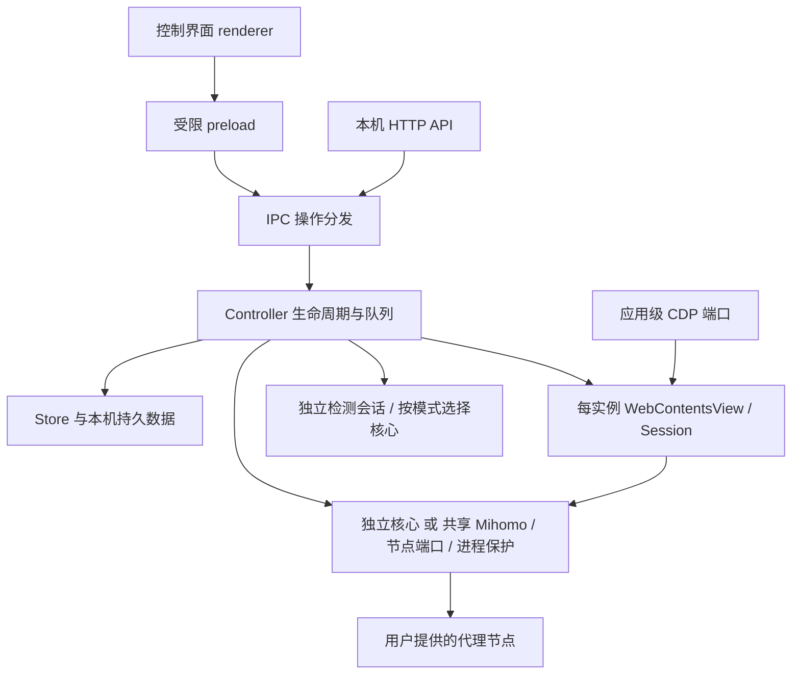

# 千面 Facet：项目总览与维护手册

更新：2026-10-22。以 v0.2.18 为基线的当前源码；共享节点端口改造尚未发布。项目以用户隐私保护与内置 AI 助手为核心；本版补充扩展 ZIP 导入，修复 DNR 执行、网页复制、备注拖选和环境重置。待开发能力见 [交付状态](UX-DELIVERY-STATUS.md)，文档导航见 [索引](README.md)。

当前支持范围以 [CURRENT-SCOPE.md](CURRENT-SCOPE.md) 为准；旧 `SCOPE.md` 是历史。

## 1. 项目目标与技术路线

千面是以用户隐私保护为核心、内置 AI 助手的 Windows x64 多实例浏览工作台：在一个应用中管理隔离的登录存储、环境参数、代理节点、扩展与实时宫格，并由 AI 按授权协助操作实例和网页。实例资料保存在本机；使用 AI 时，相关网页内容、图片、上下文和工具结果会发送给用户配置的模型服务。它不提供代理账号或节点，也不是系统 TUN 客户端。

技术栈为 Electron 44.9.3、JavaScript、WebContentsView、Mihomo；应用更新使用 electron-updater，构建使用 electron-builder/NSIS，测试使用 Node 和 Playwright。准确版本以 `package.json`、lockfile 和资源校验清单为准。源码需要 Node.js 22.12+，建议使用包含 2026 年 10 月安全修复的 Node 22.23.4 / 24.22.1 或更新受支持版本；Windows 使用 PowerShell 和 `npm.cmd`，安装版不要求用户安装 Node。当前源码运行时安全更新及尚未被 Electron 上游完整回补的 Node 风险见[安全更新](RUNTIME-SECURITY.md)。

Linux 的部分测试记录属于辅助证据，正式发行目标是 Windows x64。环境覆盖不等于物理硬件改变，也不保证匿名、不可检测或完全无泄漏。

## 2. 当前真实功能

| 功能 | 实际行为 | 边界 |
| --- | --- | --- |
| 实例管理 | 创建、改名、启停、删除、备注、随应用启动、批量操作 | 实例 ID 是关联依据；名称可改，不能按列表顺序控制 |
| 内置 AI | 自选模型服务、图片输入、流式回复、多会话与持久上下文；按权限操作实例和网页 | 默认未配置；相关内容会发送给所选模型服务；不自动恢复中断任务 |
| 会话隔离 | 每实例持久 Cookie、localStorage、IndexedDB 等网站存储 | 同一应用运行时和主机网络不等于物理设备隔离 |
| 浏览与宫格 | 实例页面真实运行，实时宫格、放大、省资源模式 | 后台网页仍受 Chromium 调度和网站行为影响；不是恒定后台执行承诺 |
| 代理库 | 最多 30 个全局源；订阅、本地 YAML/JSON 和单节点导入、更新、分配 | 全局源更新不自动重写已分配的实例节点副本 |
| 节点检测 | 连通性/延迟、出口 IP、时区语言、单节点 5 MB 测速 | 检测目标失败不必然等于节点对所有网站不可用 |
| 环境设置 | 语言、时区、UA、平台、视口、DPR、CPU、媒体偏好、定位及参考指纹 | 保存会停止目标实例；新配置启动后生效 |
| 环境重置 | 先按当前网络查询出口，再以新 ID、新分区和新随机环境重建，匹配语言时区；保留名称、代理和扩展启用列表，支持批量 | 查询失败保留旧实例；清除旧登录和扩展数据，备注、自启动等恢复默认；随机不保证每项都不同 |
| 扩展中心 | 解压目录或 ZIP 导入、权限确认、按实例启停、面板/设置、更新并重启、确认移除 | Electron 只支持部分 Chrome API；CRX、商店直装仍待做 |
| 开发者工具 | F12、浏览工具栏及 API 打开右侧开发者工具，拖动分隔条调宽 | 停止实例关闭面板；不是另一个独立 Chrome 窗口 |
| 外部控制 | 本机 API 与统一 CDP 开关，按实例对应 target | 默认关闭；开启 CDP 需重启主进程；不要开放给局域网/公网 |
| 收藏与快捷入口 | 节点引用、IP 备忘、快捷网站、检测菜单、实例音量和静音 | IP 收藏不是代理，网站入口不自动保证可访问 |
| 实例迁移 | `.facetbackup` 单独/合并导出，多文件导入及可选导出后删除 | 无密码保护，不包含插件程序和原代理凭据；登录恢复可能需网站验证 |
| 更新与诊断 | 启动及约每 30 分钟检查、同版一次提醒、手动下载安装；操作记录/调试输出/诊断包 | 详细阶段与跨重启采集已接入；源码运行不提供安装版在线更新 |

v0.2.13 接入扩展设备候选库：[组合规则、使用及验证](FINGERPRINT-CATALOG.md)。保留旧预设，普通随机保护浏览尺寸，整套方案用于新建和重置。

重置环境位于环境方案行“一键随机”之后、“撤销”之前；实例管理提供单项/批量入口。它会替换旧实例，保留名称、代理和扩展启用列表，清除旧登录与扩展数据，备注等管理字段恢复新实例默认。普通“一键随机”是表单草稿操作，保存前不会清除数据；两者不可混用。

## 3. 核心架构和职责



直连实例不启动 Mihomo，浏览 Session 使用 direct。代理实例使用固定回环 HTTP 代理；启动或运行失败不能自动切回网页直连。当前源码有互斥的「实例独立代理」（默认）与「节点端口共享」模式，前者每个实例/检测独立启动核心，后者按完整节点配置及网络策略分配端口，同配置节点在多个实例和检测任务间复用；网络策略或解析结果不兼容时分组使用不同核心。外部 CDP 是应用级单端口，两者用途不同。端口服务开关与映射持久化到 node-ports.json，重启恢复；仅监听本机。使用与故障边界见 README 的「互斥代理模式」。

| 文件/目录 | 职责 |
| --- | --- |
| `src/main/main.cjs` | 数据路径、启动开关、单实例锁、窗口、Controller/API/更新初始化、退出 |
| `controller.cjs` | 实例队列、启动/停止/重置、视图布局、宫格、开发者工具、快照 |
| `ipc.cjs`、`preload.cjs` | 控制界面请求桥和动作校验；普通网页没有管理桥 |
| `control-api.cjs` | HTTP 鉴权、端口、实例和通用动作路由、target 映射 |
| `store.cjs`、`json-storage.cjs` | 实例与节点副本、校验和单文件原子写入 |
| `library.cjs`、`subscription*.cjs` | 全局源与下载、公共地址验证、Fake-IP 公网复核 |
| `mihomo.cjs`、`process-host.cjs` | 内核运行配置、Windows 进程保护与租约 |
| `proxy-mode.cjs`、`shared-proxy-pool.cjs`、`node-port-registry.cjs` | 共享核心、按节点端口、实例/检测/外部租约、稳定端口映射 |
| `node-network.cjs` | 节点域名准备、DNS 选择、网卡/路由设置 |
| `diagnostics.cjs`、`ip-services.cjs`、`diagnostic-history.cjs` | 临时内核检测、IP 备用服务、统计历史 |
| `environment.cjs`、`fingerprint*.cjs/js`、`viewport.cjs` | CDP 环境覆盖、种子注入、视口适配 |
| `browser-network-policy.cjs`、`webrtc-policy.cjs` | DNS 预取提示控制、词典下载时机、非代理 UDP 策略 |
| `extension-*.cjs`、`extensions.cjs` | 托管扩展、绑定、面板和受限 debugger 兼容 |
| `instance-transfer.cjs`、`instance-live-export.cjs`、`instance-archive.cjs` | 导入导出、暂存任务、归档校验和恢复 |
| `deletion-*.cjs`、`cleanup.cjs`、`batch-operations.cjs` | 删除意图、残留恢复、批量结果 |
| `updates.cjs`、`update-reminder*.cjs` | 自动检查调度、提醒与用户确认下载/安装 |
| `workspace.cjs`、`runtime-output.cjs`、`diagnostic-bundle.cjs` | 收藏、操作记录、运行输出和导出 |
| `src/renderer/` | 管理表单、真实浏览区域布局、主题、宫格及交互 |
| `scripts/`、`tests/`、`resources/` | 开发/构建/发布，验证，发行依赖与许可 |

`network-trace.cjs` 已接入订阅、节点准备、检测、内核和网页失败；`network-capture.cjs` 集中管理实例 Session 的失败请求监听。`subscription-proxy.cjs` 仍是未接线草稿。

## 4. 启动、停止和数据安全

启动顺序：确认实际数据目录和单实例锁 → 处理待恢复迁移任务 → 创建控制窗口 → 初始化 Store、Controller、IPC、更新和可选 API → 加载界面 → 按已保存开关依次启动实例。资料从 `.bak` 恢复时跳过随应用启动，避免错误配置自动运行。

实例启动：队列校验配置 → 初始化持久 Session → 配置权限和网络 → 启动代理内核（如需要） → 应用环境/视口/扩展 → 加载网址。停止回收网页、扩展窗口和内核，持久存储保留。

切换实例/宫格通常操作已有视图与布局，不表示销毁并重开网页。网页播放、定时器和后台任务取决于可见性、后台节流、扩展窗口和网站逻辑；需要常驻后台活动时必须用实际网页验证，不能保证和多个独立 Chrome 进程行为完全一致。

删除、重置、导出后删除有不同语义。修改前盘点目标 ID，保留备份；批量成功和失败项单独记录。JSON 原子提交保护单文件，不应宣称任意跨文件操作或断电都具备数据库事务保证。

## 5. 实际数据位置和结构

数据路径由 `app-paths.cjs` 决定：

1. `--user-data-dir=绝对路径` 明确指定时优先使用，不接受相对路径。
2. 没有指定时，已有 `%APPDATA%\ArenaCore` 则沿用它。
3. 没有旧目录的新安装使用 `%APPDATA%\Facet`。

安装目录、源码目录与用户数据目录是三回事。默认安装路径为可用 D 盘的 `D:\Facet`，否则 `C:\Facet`；升级保留原路径。不要按名称猜测正在使用哪个数据目录。

| 数据 | 内容/风险 |
| --- | --- |
| `instances.json`、`.bak` | 实例 ID、名称、环境、网络、备注、随应用启动和全局音量状态 |
| `Partitions/arena-core-<id>/` | Chromium 持久存储与登录状态，含敏感网站数据 |
| `proxy-sources/<id>.json` | 实例节点副本、订阅/分配元数据，可能有明文凭据 |
| `proxy-library.json` | 全局源、原始订阅地址和节点，可能有明文令牌/密码 |
| `workspace-tools.json` | 节点引用、IP 备忘、快捷网址及迁移版本 |
| `extensions.json`、`extensions-packages/` | 托管程序与元数据/实例绑定；各实例扩展网站存储仍在其 Session |
| `node-network.json`、`.bak` | 节点 DNS/路由/网卡，不等于系统网络配置 |
| `control-api.json` | 开关、API/CDP 端口和访问令牌，禁止分享 |
| `app-settings.json` | 退出偏好、已提醒的更新版本 |
| `global-events.json`、`runtime-output.json` | 操作历史与本次调试输出，仍应在分享前检查 |
| `diagnostic-history.json` | 节点检测累计统计和近期结果 |
| `core-runtime/`、`diagnostic-runtime/` | 临时内核运行配置/租约，可能含凭据，不应上传 |
| `deletion-journal/`、批量操作目录 | 删除/批量任务的执行状态与恢复记录 |
| `instance-import-cookies/`、待导出任务与结果 | 系统加密暂存 Cookie/任务以及恢复结果，仍按敏感资料保管 |

运行实例关联结构：`instance.id` → Session 分区、runtime Map、节点副本与扩展绑定。全局检测使用 `sourceId + nodeName + kind` 关联；不要仅按节点名称合并不同订阅。迁移会创建新实例 ID，不直接覆盖同名实例。

## 6. 网络、DNS 与隐私边界

三个独立环节必须分清：

| 环节 | 当前路径 | 调整影响 |
| --- | --- | --- |
| 下载订阅 | Node HTTP(S)，系统网络及公网地址校验；Fake-IP 时进行公网复核 | 节点 DNS 面板不控制这个下载器；指定代理仍开发中 |
| 连接节点服务器 | 实例/检测的 Mihomo 与 NodeNetwork | 系统/自动/安全/严格 DNS、系统/物理/指定网卡影响此环节 |
| 网页访问目标网站 | 实例 Session → 固定代理或明确直连 | 网页 DNS 可能涉及节点、中转、浏览器和宿主路径，检测地区不能单独证明泄漏来源 |

默认节点模式为系统 DNS、系统路由；安全和自动兼容失败时允许回退系统解析再尝试，严格模式失败拒绝启动。保存不重启运行实例，下次启动或检测生效。系统线路可能仍被宿主 TUN 接管，只有实际路由测试能判断出口。

QUIC 默认禁用，WebRTC 限制非代理 UDP；网页 DNS 预取提示关闭，词典下载延后至网络配置完成。这些措施不能保证所有协议、扩展、后台服务或代理服务器的 DNS 完全无泄露。更新检查、订阅下载等应用服务与实例网页的代理路径不同。

外部网页开启沙盒、上下文隔离、无 Node/管理 IPC。权限默认拒绝，已配置定位及受限可读文件访问按实现例外处理。导出诊断不能包含登录资料；导出实例备份则明确包含敏感网站存储，两个产物不可互换。

## 7. 扩展与开发者工具

导入包含 `manifest.json` 的解压目录，审查权限后复制到托管位置，默认禁用。启用/停用与更新对受影响实例按确认范围执行；移除允许确认后停止使用该扩展的实例并解除绑定，不需要用户先逐一手工停用。保留实例登录与扩展存储，不能以“已加载”代替网页功能验证。

v0.2.13 补充常用扩展 API 和实例内 debugger 命令，当前具体范围见 [扩展兼容层](EXTENSION-COMPATIBILITY.md)。不提供任意跨实例读取，也不影响外部统一 CDP target。Dark Reader 的历史功能失败记录仍须保留，不能据此承诺所有版本都可用。CRX3/ZIP 导入、商店安装及完整 Chrome API 支持另行评估。

开发者工具是自定义 WebContentsView 面板与拖动分隔条，不应再出现独立空白窗口。修复该类 UI 时要看真实窗口/视图布局，控制页面截图不总包含子原生网页画面。

## 8. 导入导出、删除与恢复

实例备份默认每实例一个 `.facetbackup`，可合并；带归档校验但没有密码。网页登录数据、持久存储与环境/管理信息按允许范围导出；插件程序、绑定和原节点凭据不随包迁移。只短暂停止所选实例和关联活动，其他实例不受影响，结果完成或失败恢复原运行状态。

“导出后删除”默认关闭。只有备份实际生成并重新读取校验通过才进入删除；保存取消、失败或校验失败保留原实例。删除失败明确说明残留，不应把“任务已接受”当作资料已安全删除。

导入先验证归档、路径、大小和元数据，再选择新的代理或明确直连；创建新实例并保留原环境与备注，重复名字加后缀。时区语言同步失败保留已导入资料并提醒。系统加密暂存首次启动 Cookie，启动恢复后清理；两端需同系统和相同 Electron 版本，网站仍可因 IP、设备或会话失效要求重新登录。

排障/恢复先正常退出，备份实际用户数据目录到受控位置，再检查原文件与 `.bak`、任务记录和软件版本。不要在线覆盖运行中的 Chromium 存储，不盲目删除 Cookie 暂存、删除意图或导出任务记录，也不要上传整个数据目录。

## 9. 本机 API 和 CDP

开启应用设置中的外部控制后，API 只监听 `127.0.0.1`，请求带 Bearer 令牌；CDP 启用需重启主进程。令牌只从当前界面/受控本机配置读取，不写进脚本仓库、文档或截图。

推荐顺序：`/v1/status` → `/v1/instances` 按 ID 选择 → `/v1/targets` 得到对应 targetId → 专用接口或 `/v1/actions` → 查状态、target、磁盘与重启结果。Playwright 通过 CDP 操作网页，管理功能通过 API 操作。

同 URL 不同实例必须按 targetId 区分，不能只用 URL、序号或窗口标题。CDP 同一端口不取消 Session 存储隔离，但能访问该端口的工具拥有较强控制能力；HTTP API 的 Bearer 令牌不是 Chromium CDP 自身的认证令牌。本机回环限制也不意味着所有本机程序都可信。

详细字段、错误响应和确认边界见 [CONTROL-API.md](CONTROL-API.md)。文件选择、原生确认窗口仍需要真实交互，不伪造确认结果。

## 10. 更新和发布流程

Windows 安装版启动加载后检查一次，随后每次自动检查结束约 30 分钟再检查。检查不重叠下载/安装，已下载结果保留。同一版本只有提醒实际显示并记录后才不重复，记录跨重启保存。

弹窗展示 Release 内容、个人开发者一冬声明、项目地址、Star 提示与按钮；“立即更新”开始下载，安装仍需确认退出。更新说明来自 GitHub Release，下载清单为 `latest.yml`，SHA512 用于文件校验；草稿、预发布和降级不作为普通稳定更新。

开发启动：

```powershell
npm.cmd ci
npm.cmd run setup:core
npm.cmd start
```

已有依赖和已校验资源无需重复安装。只测试直连可以跳过 setup:core；资源完整时不为了改 UI 编译内核。修改主进程必须正常重启，刷新控制页面不会加载新主进程逻辑。

构建和发布：

```powershell
npm.cmd version patch --no-git-tag-version
npm.cmd run check
npm.cmd run test:control-api
npm.cmd run test:updates
npm.cmd run test:packaging
git diff --check
npm.cmd run build:installer
npm.cmd run test:installed -- "打包程序的绝对路径\Facet.exe"
```

创建本次 `docs/releases/v<版本>.md`，完成专项验收后单独提交、推送，再执行：

```powershell
npm.cmd run release:publish -- docs/releases/v<版本>.md
```

发布脚本要求工作区干净、HEAD 与 origin/main 一致，校验版本/文件/SHA512；先创建草稿上传 exe、blockmap、SHA256、latest.yml 四件，再核对资产大小并公开设为最新版。发布后核对 targetCommit、tag、latest 和远端 SHA256。安装包存放 `release/`，不强制加入 Git；“提交源码”不代表发布安装包。

已有公开版本不能覆盖成另一构建；递增版本让更新器能识别。安装包目前未签名。打包使用已验证 Mihomo/进程保护/本地 Electron runtime，构建日志的 signing 阶段不证明具备可信发布者签名。

## 11. 测试、证据与已知限制

按修改范围运行测试，详细分组见 [VERIFICATION.md](VERIFICATION.md)。最低为 check、control-api、diff；涉及网络、备份、扩展或 UI 时还必须测真实下游状态与持久化。模拟 IPC、受控上游、真实 Electron、公网节点和安装向导分别报告，不混称“全部测试通过”。

v0.2.12 发布时有 15 项打包程序隔离验收通过，包含 API、代理、会话、重启、开发者工具及环境重置。该证据来自当时构建，不代表本次新增草稿完成验证，也不代表全部用户机场兼容。

本机从源码目录或构建目录启动 Electron / Facet.exe 会以 `0x80000003`（STATUS_BREAKPOINT）退出。2026-10-23 查明根因与盘符无关：开发机的 `D:\AProgram\arena` 等目录带有可继承的 **Low Mandatory Level** 完整性标签，其下的 exe 启动后以低完整性运行，Chromium 在 JS 与日志之前中止。同一运行时复制到无标签的 D 盘目录即正常，给 C 盘副本加上低标签则复现。默认安装目录 `D:\Facet` / `C:\Facet` 不受影响；只有把程序放进带低标签的目录（如 `AppData\LocalLow` 或被沙盒 / 文件夹防护工具标记的目录）才会出现。开发启动器在这种情况下会说明原因并使用 `%LOCALAPPDATA%\FacetRuntime` 中校验一致的副本；打包验收应把 `win-unpacked` 复制到无标签目录后运行。不关闭沙盒，也不改动原目录的安全设置。Playwright 浏览器版本缺失也应按测试环境问题单独记录，不隐藏为成功。

当前缺口：跨设备 TUN/DNS/多网卡矩阵、某些扩展 API、长期大量实例负载、完整字体/硬件一致性、防泄露覆盖、订阅线路兼容及详细网络错误采集。`test:experience` 历史出现夹具未实现 `isDevToolsOpened`；本次仅整理文档，不宣称该项已修复。

## 12. 排障顺序

| 现象 | 优先证据与动作 |
| --- | --- |
| Clash 能更新，千面超时 | 同机同链接对比实际下载线路、DNS、地址族与响应阶段；Clash 更新未必跟随页面选中节点 |
| 订阅解析到非公网地址被拒绝 | 在故障设备查实际域名解析；常见 Fake-IP 与回环/私网是不同情况，不能直接关校验 |
| 导入成功但节点 DNS 失败 | 分开查节点服务器解析和检测目标；节点 DNS 设置不改变订阅下载器 |
| 某网页无法打开 | 看实际目标错误、出口查询和另一个目标；不要据单站失败把整实例判为失效 |
| 页面不跟随外部工具操作 | 按 instanceId/targetId 确认，查询 UI 路由与 focus；HTTP 成功不是网页已变 |
| 改源码无效果 | 确认启动目录、实际程序/版本、用户目录；主进程需重启，asar 与源码副本不能混用 |
| 登录数据/备份异常 | 先保留原目录、备份与任务记录；读取状态和校验失败，不重复覆盖或执行删除 |

反馈建议：复现后立即从系统日志导出详细诊断包，附时间、操作步骤和脱敏截图。v2 包包含跨重启输出、订阅阶段、内核和网页失败及检测历史；查看 summary.issues 后按任务 ID 查 network.rows 和 debug.rows。采集上限与隐私边界见 [日志说明](DIAGNOSTICS.md)，旧版未采集的内容无法补回。

## 13. 后续工作与维护约束

详细诊断和 ZIP 扩展导入已接入；订阅指定代理、CRX3 与商店直装仍待推进。详细状态、设计与验收清单见 [专项方案](SUBSCRIPTION-NETWORK-DIAGNOSTICS.md)、[扩展文档](EXTENSIONS.md) 与 [交付状态](UX-DELIVERY-STATUS.md)。

默认中文协作；先确认实际仓库、分支、运行程序和目标文件，再做最小修改。保持结构、数据和验证过的流程，代码改动前备份；大改使用检查点。完成意味着实际文件、业务状态和验证结果交付，不意味着请求已接收。

文档维护不改变用户数据或代理/VPN。未接线的代码草稿保留在本机，不纳入已实现功能或本次安装包；后续功能接线后须单独验收。
